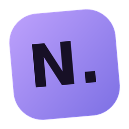

# NoorMD Desktop

A local-first Markdown writing studio for Windows: a WPF (C#) application with a
WebView2-hosted editor (visual WYSIWYG, Markdown source and split preview), native
file dialogs, crash recovery and revision snapshots. No account, no telemetry and no
web services.



## Download and run

1. Get `NoorMD-2.0.0-preview.52-win-x64-portable.zip`. Use the build attached to the GitHub Actions
   run (artifact **NoorMD-win-x64**), or build it yourself (see below).
2. Extract the zip to any folder, for example `C:\Tools\NoorMD`. Do not run it from inside
   the zip.
3. Run `NoorMD.exe`.

**Requirements**

| | Portable zip (recommended) | Small zip |
|---|---|---|
| Windows 10 (1809+) / 11, x64 | ✔ | ✔ |
| Microsoft Edge **WebView2 Runtime** | ✔ required: preinstalled on Windows 11 and current Windows 10 | ✔ required |
| .NET 10 Desktop Runtime | not needed (bundled) | required |

If WebView2 is missing, NoorMD tells you and links to Microsoft's free installer
(<https://go.microsoft.com/fwlink/p/?LinkId=2124703>). The binaries are **not code-signed**,
so Windows SmartScreen may show "Windows protected your PC". Choose *More info → Run anyway*,
or right-click the zip → *Properties* → *Unblock* before extracting.

## The Noor family

Every part of NoorMD is named Noor-something (since preview.116); the older names in brackets.

| Name | What it is |
| --- | --- |
| **NoorMD** | The Markdown editor, documents and vaults: the workspace the others live in |
| **NoorSketch** | Quick sketches and small drawings |
| **NoorSprite** | Pixel art, sprites and 2D animation |
| **NoorPhoto** (planned; was NoorCanvas) | Photo editing, digital painting and layered pictures |
| **NoorInk** (planned) | Vector graphics: SVG, illustration and design |
| **NoorMesh** (planned) | Low-poly 3D modelling, mesh editing, UV mapping and simple animation |
| **NoorForm** (Asset Bench) | Procedural 3D assets: trees, rocks and more, with levels of detail |
| **NoorForge** | Texturing 3D models: painting, smart materials and baking |
| **NoorMaterial** (Texture Bench) | Procedural PBR materials and textures |
| **NoorSound** (Sound Bench) | Sound effects, synthesis and ambiences |
| **NoorSequencer** | Music: composing, sequencing and soundtracks |
| **NoorMusic** (Music Bench) | The music player and library: playlists, tags, triage |
| **NoorVideo** (Video Bench) | Video playback, library and notes over videos |
| **NoorGallery** (Gallery) | Pictures: browsing, albums, batch work and slideshows |
| **NoorRadio** (Radio) | Internet radio: stations and favourites |
| **NoorVoice** (Voice notes) | Voice recordings and audio notes |
| **NoorStream** (Stream Desk) | Streaming: overlays, OBS, now playing, credits |
| **NoorCalendar** (Calendar) | Calendar, schedules, events and reminders |
| **NoorHub** (Apps Hub) | Launching your apps and shortcuts |

File names, folders and recipes keep working as they were: only the names you see changed.

## Languages

NoorMD speaks English, Polski, Deutsch, Français and Español (Preferences › Language). The page changes at once;
the app's own windows (file dialogs) change at the next start. Polish, German, French and Spanish are drafts —
corrections are welcome.

**Your own translation:** Preferences › Language › *Make a translation…* saves a file with every English text
NoorMD shows and an empty slot beside each (or what a language has already, to correct it). Fill in what you like
— an empty slot stays English, and `{0}`, `{1}` stand for numbers and names — and keep the file in
`Documents\NoorMD\Translations` named by the language's code (`it.json`, `pt-BR.json` …). Choose it in
Preferences. Your lines win over the built-in ones, so the same folder is where you fix a word you don't like.

For developers: the list of English texts (`src/NoorMD/wwwroot/lang/en.json`) is made by
`node scripts/i18n-extract.js`; run it after changing what the app says.

## Features

- **Open, save, Save As** with native Windows dialogs. Files are written atomically (temp
  file + replace) and the previous version is backed up. The original encoding (UTF-8 with or
  without BOM, UTF-16), line endings (CRLF/LF) and final newline are kept.
- **No silent data loss.** You get a Save / Don't save / Cancel prompt when you close a modified
  tab, and a list of all modified documents when you close the window. Unsaved text goes to a recovery draft about 0.6 s after you stop typing. After a
  crash or power loss, NoorMD offers the draft the next time it starts.
- **Menus and a customizable toolbar.** File, Edit, Insert, Format, View, Workspace, Media,
  Tools and Help (Alt+letter, F10), plus a grouped toolbar you can hide, label, shrink or
  reorder. Everything also runs from Ctrl+K and from shortcuts: it's one set of commands.
- **Vaults.** Open any folder as a Vault and get:
  - an explorer: new, rename, move by drag, duplicate, delete to the Recycle Bin;
  - Find in files (Ctrl+Shift+F): every open document or every note in the Vault;
  - renaming or moving a note in the explorer (F2, right-click › Rename, or drag) updates the
    links to it. Renaming in Windows Explorer or *Save As* doesn't, because NoorMD isn't asked;
  - tags (`#idea`, nested `#project/alpha`, or `tags:` in front matter) under Sidebar › Tags;
  - a new-Vault wizard with starting points (personal notes, writer, worldbuilding, creator, game dev);
  - notes that link here, `[[wiki links]]` and relative pictures.

  It stays an ordinary folder: nothing is written into it except your notes, and other tools'
  folders (`.obsidian`, `.git`) are left alone.
- **Pack & Share.** Right-click a folder or a selection and get one ZIP:
  - a preview first;
  - visible exclusion rules that keep secrets out;
  - optional linked files;
  - an **AI Handoff** option with a manifest and your own instructions.

  Nothing is uploaded.
- **NoorSketch.** A quick sketchpad in its own window:
  - brush and eraser, undo, zoom, canvases up to 4096×4096;
  - exact `.noorsketch` files and PNG export;
  - **Insert into document** adds the picture with a relative link.
- **Tabs for several documents.** Ctrl+T, Ctrl+O, Ctrl+Tab, Ctrl+W, drag to reorder, pin, and
  a searchable list of open documents (Ctrl+E). Every tab has its own editor, undo history,
  encoding, recovery draft and snapshots. Ctrl+S saves only the visible tab. The open tabs come
  back the next time you start NoorMD, including unsaved work after a crash.
- **Three editing modes:** Visual (WYSIWYG), Markdown source and Split. The Split view has a
  draggable divider (30–70 %) whose position is remembered, independent scrolling (sync is
  optional), and stacks vertically when the editor is narrow.
- **A round-trip guard.** The Visual editor cannot represent every kind of Markdown; raw
  HTML, footnotes and hard line breaks are examples. NoorMD detects this when a file opens. It
  then opens the file in Markdown mode so nothing is rewritten, and asks before switching. A
  file that is only opened, never edited, is never re-saved.
- **Focus mode** (F11): the document fills the whole window. With a bench in the middle (NoorMaterial, NoorForm,
  NoorSequencer, NoorSound) the bench gets the whole window instead; its ⛶ button does the same, and “Back to
  NoorMD” (or Esc, F11) brings the menus, tabs and panels back.
- **Studio tools:** document outline with navigation, word/character counts, reading time,
  a writing goal, a command palette (Ctrl+K), find & replace (Ctrl+F / Ctrl+H) and revision
  snapshots with preview, restore and delete. Snapshots are kept across restarts.
- **Export:** Markdown copy, standalone HTML (sanitized, scripts blocked by CSP), PDF and
  Print through the Windows print dialog. Microsoft Print to PDF works too.
- **Light and dark themes.** The window title bar, the dialogs and the editor all follow the
  theme, and dark mode starts without a white flash.
- **Line width presets:** Comfortable (≈ 800 px), Wide (≈ 1100 px) and Full width. Change
  them with the ↔ button or Ctrl+Shift+W, in normal and Focus mode.
- **Markdown source editor:** plain text in one monospaced font (JetBrains Mono, bundled) and
  one size, with subtle syntax colours, line numbers, optional word wrap and a current-line
  highlight. Shortcuts for headings, links and code blocks, and Copy Markdown source.
  Switching modes never rewrites source you didn't edit in Visual mode.
- **Nine colour themes** with a live-preview picker (Theme button, Ctrl+Shift+T to cycle).
  All are contrast-checked.
- **Creator's Bench: NoorMusic** (Ctrl+Shift+M, optional):
  - A local music library with fast search and triage (Favorite, Keep, Maybe, Skip).
  - Playlists, an Up next queue, and a persistent mini-player.
  - **Edit current track (F2)**: tags and/or file name, with safe renames and undo.
  - Multi-select (click, Shift, Ctrl) with a right-click menu: playlists, queue, marks, more.
  - **Batch Organizer**: tags and file-name templates for many tracks, a dry-run preview with
    collision checks, and undo of the whole batch.
  - **Sound**: 10-band equalizer with presets, clipping prevention, and loudness levelling
    (BS.1770 measurement or ReplayGain). Files are never changed.
  - **Smart collections**, shuffle and 🎲 random, cover.jpg artwork.
  - Session resume.
- **NoorVideo** (Ctrl+Alt+V), a video player that works like NoorMusic:
  - a library with search, filters (unwatched, in progress, watched) and series, multi-select and a
    right-click menu; the playing video is highlighted;
  - Up next with shuffle and repeat, and **playlists** — e.g. a whole TV show in one click;
  - resume where you stopped, subtitles (SRT/ASS/VTT), a choice of **audio track** (language),
    speed, timestamped notes you can insert into a document, and a pop-out player that stays on
    top.
- **NoorGallery** (Ctrl+Alt+G): the pictures in folders you add, with subfolders as albums. View them full size
  (zoom, favourites), put one into the note, and play slideshows with fade or slow zoom and music from
  NoorMusic. Saved slideshows keep their order and settings. With room (in the middle) it becomes a
  picture manager: albums on the left, details on the right, rename (also as a numbered series), move to
  albums by dragging, new albums, delete to the Recycle Bin, and Ctrl+Z to undo a rename or move.
  It shows work files too (PSD, Affinity, TIFF, HEIC) with their previews, opens pictures in your editor
  (right-click › Open in), copies or moves them to any folder, packs them into a ZIP, and finds duplicates.
  Give pictures stars (keys 1–5), colour labels (6–9) and tags, browse them by tag or by year and month,
  and turn them (Ctrl+R; JPEG photos without any loss). Convert or resize many at once (JPEG or PNG, any
  size) into copies, for sharing or the web; the originals stay as they are.
- **NoorVoice** (Ctrl+Alt+D): record, listen, save as Opus or WAV next to your notes and link it
  into the document. The microphone is used only while you record.
- **NoorSound** (Ctrl+Alt+K): sound effects and ambiences for games, made on your computer. 🎲 Generate a
  pickup, laser, explosion, footstep, impact, whoosh, magic or sci-fi sound and more, start from one of 55
  presets (weather, footsteps, machines, UI, retro, alarms…), or layer your own WAV files (trimmed on their
  waveform, stretched without changing pitch, or scattered into grain clouds). Shape them with plain controls
  (gentle ↔ violent, near ↔ distant, outdoors ↔ indoors…) or layer by layer, with effects racks (including
  resonators and convolution reverb in real or recorded spaces), shared buses,
  your own named controls (*Motor RPM*) and modulators (LFOs, envelopes, random drift, steps, drawn curves) that
  move any setting over time, all shown on a map of connected blocks. Listen as you change things, see the
  spectrogram and loudness meters (LUFS, true
  peak, stereo), compare A/B and a reference clip at matched loudness, make variations, and export WAV or OGG files
  (seamless loops or one-shots, optionally at a loudness target and with stems) with the recipe beside them;
  optionally kept in your Vault and added to NoorMusic to audition and rate.
- **NoorMaterial** (Ctrl+Alt+T): tileable materials for games, made from a recipe: start from a preset (stone,
  ground, wood, metal, walls, fabric), from scratch, from a random stack, or from pictures chosen in the Gallery. Layers of noise, Musgrave fractals, Voronoi cells, waves, gradients, checkers, Magic, wood grain, bricks, tiles, hexagons, planks, spots (pebbles,
  rivets, craters), weave, scratches and your own photos (made seamless, light evened out, height from their
  detail) build the height, and erosion (rain, crumbling, wear) reshapes it. Make full PBR sets for many albedo textures or photos at once (batch, also from NoorGallery). Paint on a material by hand in
  NoorSketch (the material underneath, strokes carrying on across the edges so it still tiles) and apply it
  straight back as a layer of the recipe. Any layer can paint tint, roughness
  and metal, masked by the material's own height and edges; a colour ramp, dirt and roughness make the surface.
  See it on a sphere, rounded cube, cube or plane under five lights (or as grey clay, or one map at a time), or each map tiled, and export seamless PNG maps (albedo, normal,
  roughness, AO, metallic, 16-bit height) for Godot, Unity or Unreal at up to 4096 pixels, with the recipe
  (and its paintings) beside them; optionally shown in NoorGallery and the recipe kept in your Vault. Exports (and
  NoorSound's) can go straight into a game project, arranged for Godot, Unity or Unreal or by your own
  folder and file-name pattern, with a preview of every path.
- **NoorSequencer** (Ctrl+Alt+Q): a friendly composer for loops, jingles and simple game soundtracks. Start from a
  mood (cozy exploration, tense dungeon, cheerful arcade, lonely ambient) or an empty song. Tracks × bars of
  numbered patterns, as in BeepBox: change a pattern once and every bar playing it changes. Write melodies in a
  piano roll that shows (or only offers) the notes of your key and scale, beats in a drum grid, and choose each
  track's sound: a synth (sine to saw, two detuned voices, envelope, filter, vibrato), a synthesised drum kit, or a
  WAV of your own played at any pitch, with NoorSound's effects. Help for non-musicians: the chords of your
  key with their mood in plain words, whole chord progressions (with a bass line) written for you, drum rhythms,
  variations of a pattern, instrument presets, an arpeggiator, humanize, an LFO and FM, and level and filter
  automation over the song. For games: adaptive layers (exploration, danger, combat…) that a game can crossfade,
  with the change between them to listen to, and a loop check (click at the seam, tail, level at both ends). Use
  NoorSound sound or a WAV from NoorMusic as an instrument. Play from any bar or the loop over and over,
  and export (⤓ Export at the top) the song, a seamless loop (its tails wrapped into the start), each layer's
  loop, stems and MIDI, as WAV or OGG, optionally kept in your Vault, arranged for Godot, Unity
  or Unreal or into a game project, with the song beside them.
- **NoorCalendar** (Ctrl+Alt+C): important days, birthdays (with the age they turn), appointments, reminders, streams
  and anything else, in a month, week or agenda view, with search. Entries can repeat (daily, on chosen weekdays,
  monthly on a day or on "the 2nd Tuesday" or "the last Friday", yearly), skip a day or move just one time, and
  have reminders: shown in the app, and near the clock with a taskbar flash when NoorMD is in the background; what
  came due while NoorMD was closed is shown when it starts. Import and export .ics files (Google, Outlook, Apple
  and other calendars). Kept on your computer, saved safely with a backup.
- **NoorForm** (Ctrl+Alt+M): game-ready trees, realistic or stylized (the chunky, painted fantasy look). A
  tree grows from a recipe (trunk, roots, up to three levels of branches, crown shape, lean, wobble, twist), and its
  wood is one organic surface: limbs grow out of the trunk with smooth collars, the base flares into roots, forks
  blend; it is not made of scaled cylinders. Keep the branches merged in one welded mesh, separate (each limb its
  own mesh, its pivot where it leaves the trunk, to animate or break off), or mixed (thick limbs welded, thin ones
  separate). Leaves are alpha cards from a generated leaf atlas (broad, round, maple-like or needles), either along the
  branches or gathered into chunky tufts (the stylized look, with no solid mesh in the canopy); solid painted clumps
  are an option too; bark from NoorMaterial material or a plain colour. Every tree is
  simplified to a triangle budget with levels of detail, carries wind data (trunk sway, branch bend, leaf flutter,
  phase) in its UVs or vertex colours, and is previewed in 3D exactly as exported, with the wireframe, each part
  in its own colour, the wind data, and the wind playing. Export GLB files (Y up, metres, the pivot at the base,
  textures inside) with the recipe and a manifest beside them, to a folder or a game project (Godot, Unity, Unreal
  layouts). Over thirty presets, realistic and stylized: forest (oak, pine, spruce, birch, autumn maple), swamp and
  marsh (bald cypress with knees and hanging moss, mangrove on stilt roots, weeping willow, bog snag, a haunted
  swamp tree), giants (giant sequoia, fluted), tropical (palm, tree fern, baobab), dry and windswept (juniper,
  acacia) and fantasy (moonlit elder, ember oak, spirit willow). Trunks can be fluted, swollen or S-curved, roots
  flared, snaking over the ground or on stilts; leaves set as crossed pairs, stars, fans, domes, hanging willow
  curtains or palm fronds; branches hung with moss and vines. Export variety packs: many trees of one kind at once,
  each from its own seed and a little taller or shorter. Fantasy trees too: mushroom trees (fly agaric, a
  glowing swamp glowcap, a giant toadstool) and crystal trees with glowing shards. Bark is made in each tree's
  colour (realistic furrows, painted grooves for the stylized look, birch); a painted shading in the vertex colours
  darkens the inside of the crown and the foot of the trunk. Exports are made for your engine, Godot first: one
  file with every level, plus a small Godot import plugin (addons/noor_trees, put in your project's addons folder
  when you export into a Godot project; turn it on once in Project Settings → Plugins) that switches the levels by
  distance and gives the tree the wind shader with its own textures. For Unity (a LOD Group from the _LOD0… names)
  and Unreal (a file per level) an HLSL wind function comes along. The last level of
  detail can be a billboard: the tree drawn from its sides onto crossed cards. Bring your own bark texture or leaf
  picture (a 2 × 2 atlas or a single twig) if you like. Crowns look full for few triangles: each card can
  show a spray or a dense cluster of leaves, cards can be made bigger without adding more, a leaf budget caps the
  leaves' triangles (bigger cards instead), and outer leaves put the cover where it is seen. Rocks come next.
- **NoorRadio** (Ctrl+Alt+I): your internet radio stations, with favourites, tags, recent ones and a sleep
  timer. The song title comes from the stream and can feed NoorStream's Now Playing. Add a station
  by its address, import .m3u/.pls lists, or search the free Radio Browser directory (online, only when
  you search). One sound at a time: radio, music and video make way for each other.
- **NoorHub** (Ctrl+Alt+H): tiles for your programs, games (Steam/Epic shortcuts too), folders,
  files and websites, with their Windows icons or your own pictures. Category chips (All, Recent,
  and your own categories) choose what is shown.
- **The middle is a dock too:** put any panel (NoorGallery, NoorStream, NoorMusic…) *In the middle* from its
  ⊞ button. It opens as a tab next to your documents and fills the editing space. Click a document tab to
  get back to writing. The *Streaming, desk in the middle* layout does this for NoorStream.
  There NoorMusic becomes a full player (Now playing and Up next beside a library with sortable
  columns), NoorGallery a picture manager, and NoorVideo puts its lists beside the player.
- **Docks and layouts:** NoorMusic, NoorVideo and NoorStream dock left, right or under the
  document (⊞ on each panel). The sidebar can sit on either side. Use ready-made layouts (Writing,
  Music + video, Streaming…) or save your own (View › Layout).
- **NoorStream** (Ctrl+Alt+B), docked like the other panels or in its own window (⧉) next to OBS.
  OBS overlays are served on 127.0.0.1 only:
  - a **Now Playing** overlay with six customisable designs, and a now-playing.txt;
  - a **credits roll** of your supporters, with effects you can build;
  - the **supporters list** and a **stream log** with templates and a recorded tracklist,
    kept as notes in your Vault. NoorMD never publishes anything.
  - **Mic Guard:** one system-wide hotkey mutes the Windows microphone (so Discord hears silence
    too) and OBS's mic source together, reads both back, and shows LIVE / MUTED / CHECK in a
    floating indicator that OBS doesn't capture. The OBS password stays in Windows Credential
    Manager.
  - See [docs/CREATORS_BENCH_PLAN.md](docs/CREATORS_BENCH_PLAN.md).
- **Compact layout** (Ctrl+Shift+L) for more vertical room. **Spellcheck on/off**
  (Ctrl+Shift+Y) uses the Windows spell checker and the languages installed in Windows.
- **Preferences:** writing font (Inter is bundled), text size, line width, layout,
  spellcheck, the mode for opening files, and whether to reopen the tabs from last time.
  You can also clear recent files or recovery drafts here.
- **Recent files**, **drag & drop** to open, and **New window** (in the command palette) to
  see two documents side by side.
- **Works fully offline.** The editor, fonts and every script are bundled; nothing is loaded
  from a CDN.

See [docs/SHORTCUTS.md](docs/SHORTCUTS.md) for keyboard shortcuts.

## Build from source

Prerequisites: **.NET 10 SDK** on Windows. On Linux or macOS the solution also builds, because
`EnableWindowsTargeting` is set, but you need a Microsoft-built SDK; distro "source-built"
SDKs lack the WPF pack. Internet access is needed only during the build, for NuGet restore.

```powershell
dotnet restore
dotnet build NoorMD.sln -c Release
dotnet test tests/NoorMD.Core.Tests
dotnet run --project src/NoorMD          # starts the app (Windows)
```

Release packages:

```powershell
powershell -ExecutionPolicy Bypass -File scripts\publish-win-x64.ps1
# -> artifacts\NoorMD-2.0.0-preview.36-win-x64-portable.zip  (self-contained, ~70 MB)
#    artifacts\NoorMD-2.0.0-preview.36-win-x64-small.zip     (needs .NET 10 Desktop Runtime)
```

`scripts/publish-win-x64.sh` produces the same zips when cross-building from Linux.

### Tests

| Suite | What it covers | Command |
|---|---|---|
| `tests/NoorMD.Media.Tests` (xUnit) | tag reading and writing on real MP3/FLAC/OGG/WAV files (checked with ffprobe), safe renames, collisions, read-only and missing files, the index and relinking, a 20,000-track query benchmark, M3U, HTTP ranges | `dotnet test tests/NoorMD.Media.Tests` |
| `tests/NoorMD.Core.Tests` (xUnit) | encodings and line endings, atomic writes, recovery locking, snapshots, path traversal, the link policy, HTML export, bridge protocol, settings | `dotnet test tests/NoorMD.Core.Tests` |
| `tests/web` (Playwright) | the real editor UI against a mock host: modes, split divider, focus mode, themes, outline, find/replace, palette, XSS, offline loading, the round-trip guard | `cd tests/web && npm i && npx playwright install chromium && node ui.test.js` |
| `NoorMD.exe --self-test <dir>` | the packaged app end to end on Windows: open → edit → recovery draft → save (CRLF and diacritics kept) → split → focus → theme → PDF, with screenshots | runs in CI ([.github/workflows/build.yml](.github/workflows/build.yml)) |

## How it works

```
src/NoorMD.Core      platform-neutral C#: TextFileCodec, AtomicFile, RecoveryStore, SnapshotStore,
                     SettingsStore, AssetResolver, LinkPolicy, HtmlExport, BridgeProtocol
src/NoorMD           WPF shell: MainWindow (WebView2 setup and security), MainWindow.Bridge (commands),
                     MainWindow.Documents (open/save/export/unsaved rules), ThemedDialog, ThemeManager
src/NoorMD/wwwroot   editor UI: index.html, css/app.css, js/{bridge,markdown-tools,ui,app}.js
  vendor/            TOAST UI Editor 3.2.2 (+ProseMirror) bundle, DOMPurify, Inter: built by web/vendor-build
```

- **Content and file ownership.** The web page owns the text and the "dirty" generation
  counter. The C# host owns files, dialogs, settings, drafts and snapshots. Before saving or
  closing, the host reads the editor state synchronously with `ExecuteScriptAsync`, so a
  keystroke made just before Ctrl+S or closing the window is never lost.
- **Bridge.** The page and the host exchange small, versioned JSON messages; see
  [docs/BRIDGE.md](docs/BRIDGE.md). The page has no file-system access. It can only ask for
  named commands, and every path comes from a native dialog, the recent list or a drag and drop.
- **Security.**
  - The UI is served from `https://noormd.local/` by `WebResourceRequested`, with a strict
    Content-Security-Policy (`script-src 'self'`), so markup inside a document cannot execute
    scripts.
  - Every navigation and popup is cancelled.
  - Links pass through `LinkPolicy`. http, https and mailto open in your browser after a
    confirmation. `.md` and `.txt` files open in NoorMD. Everything else is blocked:
    programs, `file:` URLs to other kinds of files, network shares, `javascript:` and custom
    schemes.
  - Browser accelerator keys, DevTools (in Release builds), downloads and permission
    requests are disabled.
  - The OBS overlay server (off by default) listens on 127.0.0.1 only. It is read-only,
    answers only GET/HEAD for a fixed set of files, and refuses requests whose Host is not the
    loopback address (DNS rebinding). It holds no secrets and accepts no commands.
- **Images:** relative image paths (``) are served from the document's folder.
  Only image files are served, and nothing outside that folder.

### Where data is stored

| What | Where |
|---|---|
| Your documents | wherever you save them |
| Settings, recent files | `%APPDATA%\NoorMD\settings.json` |
| Music index (paths, triage, playlists, queue; audio files are never copied) | `%LOCALAPPDATA%\NoorMD\Music\library.db` |
| Recovery drafts | `%LOCALAPPDATA%\NoorMD\Recovery\` (deleted when you save or choose *Don't save*) |
| Revision snapshots | `%LOCALAPPDATA%\NoorMD\Snapshots\` (50 per document) |
| Backup of the previous version of each saved file | `%LOCALAPPDATA%\NoorMD\Backups\` |
| WebView2 profile, local log | `%LOCALAPPDATA%\NoorMD\WebView2\`, `…\Logs\noormd.log` |

*Preferences → Open data folder* opens this location. NoorMD never writes next to the `.exe`.

## Known caveats

- **Visual mode normalizes Markdown.** After an edit in Visual mode, saving rewrites
  formatting details: `-` list markers become `*`, setext headings become `#`, and table
  pipes are realigned. The meaning stays the same. Content Visual mode cannot represent
  triggers the guard described above. Markdown mode always saves your text byte for byte.
- **Not supported by the editor engine:** footnotes, math and Mermaid. They are kept as plain
  text in Markdown mode. `[[Wiki links]]` show as text in Visual mode, but they're saved as real
  links, and Ctrl+click follows them.
- **Vaults.** There are no properties or graph view yet.
- **NoorSketch is raster only.** It has no shapes, text, layers or pen pressure yet.
- **Tabs, not side-by-side.** Two documents next to each other still need *New window*. Only the
  main window remembers its tabs between runs.
- **Not included:** file associations and an installer. Use *Open with → Choose another app
  → NoorMD.exe* to make NoorMD the handler for `.md` files.
- **Pasted images** are embedded as base64 data URIs, which is the editor's default.
  Dropping an image that sits in the document's folder inserts a relative link instead.
- **WebView2 itself** follows Windows' diagnostic-data settings. NoorMD turns off SmartScreen
  reputation checks and makes no network requests of its own. An image in your document with
  an `https://` address is fetched when shown.
- **Not code-signed.**

What changed between versions and how to go back to 1.0.0: [CHANGELOG.md](CHANGELOG.md).
How tabs were designed: [docs/TABS_DESIGN.md](docs/TABS_DESIGN.md).

Migrating drafts from the old single-file HTML version: see [docs/MIGRATION.md](docs/MIGRATION.md).
Test results against the acceptance checklist: [docs/TEST_REPORT.md](docs/TEST_REPORT.md).

## License

Third-party components and licenses: [THIRD_PARTY_NOTICES.md](THIRD_PARTY_NOTICES.md). The
license texts ship in the `licenses` folder of every release.
